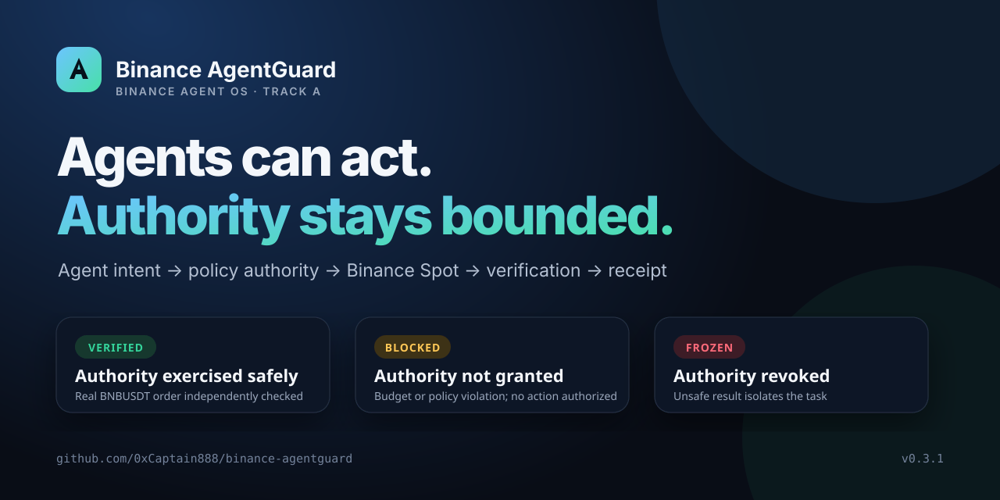

# Binance AgentGuard

> This is the Binance Agentic execution adapter for AgentGuard. It is a
> separate venue-specific build; the ETHOnline 2026 Continuity submission is
> [ethonline-agentguard](https://github.com/0xCaptain888/ethonline-agentguard).

[](https://github.com/0xCaptain888/binance-agentguard/actions/workflows/ci.yml) [](https://github.com/0xCaptain888/binance-agentguard/actions/workflows/codeql.yml) [](https://github.com/0xCaptain888/binance-agentguard/releases/latest) [](https://0xcaptain888.github.io/binance-agentguard/)



## New: owner-custodied BSC rebalancing

AgentGuard v0.4 adds a second, deliberately separate execution path for BNB
Chain: each user owns a two-asset vault while an operator may perform only the
rebalance that the vault policy permits. The operator cannot withdraw, change
policy, pause the vault, redirect output, exceed the USD budget, accept a stale
oracle, or execute a trade that fails to improve allocation drift.

**[Preview the BSC console](https://0xcaptain888.github.io/binance-agentguard/bsc/)** · **[Read the architecture and threat model](docs/bsc-rebalancer.md)**

The GitHub Pages URL is a static UI preview. The complete interactive path uses
the local or testnet service described below; the page never fabricates a live
backend or campaign evidence.

```text
Portfolio drift → deterministic proposal → owner/operator signature
→ on-chain vault enforcement → independent RPC verification
→ VERIFIED receipt or FROZEN runner
```

Run the full local proof with mock assets and a real isolated EVM:

```bash
npm install
npm run bsc:check
npm run bsc:serve
# open http://127.0.0.1:43188/bsc/
```

`bsc:check` compiles and deploys the Solidity bytecode to Anvil, executes actual
ERC-20 transfers through the test router, checks policy failures, verifies
calldata/events/transfers from canonical RPC data, and generates receipts. It
never uses public funds and explicitly marks every receipt `campaignProof:
false`.

The Linux CI launches the actual local service in Chromium and checks
desktop execution/freeze/reset, the mobile wallet entry and horizontal
layout, owner controls during an oracle outage, wallet deployment safeguards,
rebalance submission recovery after reload or explicit wallet rejection, and
wallet changes during login/submission plus session timeout and HTTP 401 recovery.
All 18 browser cases passed in [Linux CI on October 25, 2026 (UTC+8)](https://github.com/0xCaptain888/binance-agentguard/actions/runs/40144056531),
alongside all 90 Node tests on Node 20.18 and Node 22 and the public-testnet Docker
build. Coverage includes owner-reviewed ERC-8004 registration, proof inspection,
interrupted wallet recovery and unavailable browser storage. The local EVM avoids
the console port, and browser startup waits for the HTTP health endpoint.
Wallet deployment/session cases use wallet and RPC stubs; the local trade cases
execute actual Anvil contract bytecode. Local macOS browser execution remains
blocked by the sandbox and is not reported as locally passing. Run the suite with:

```bash
npx playwright install chromium
npm run bsc:browser
```

Browser screenshots are test artifacts, not campaign evidence.

The BSC testnet path is wallet-signed and keyless on the server. It requires a
reviewed vault deployment plus two independent HTTPS RPC providers:

The BSC console and deployment page connect explicitly through **OKX Wallet**.
When multiple wallet extensions are installed, only the OKX provider is selected.
Open the local URL in a browser with the OKX extension enabled and select BNB Smart Chain
Testnet (97). The isolated local lab needs no wallet.

```bash
cp config/bsc-testnet.example.json config/bsc-testnet.json
# configure public addresses and copy .env.example to .env; set both HTTPS RPCs
npm run bsc:doctor
npm run bsc:dependencies
npm run bsc:doctor -- --online
npm run bsc:deploy-console -- config/bsc-testnet.json
# open the printed /bsc/deploy/ URL; review, confirm in the owner wallet, verify
# then review the ERC-8004 panel, register once in the owner wallet, and verify
# only after VERIFIED: set BSC_VAULT_ADDRESS in .env
npm run bsc:testnet
```

The deployment service holds no signing key. The owner reviews the addresses
and policy and explicitly confirms contract creation in their wallet. The
console prevents automatic retries after an uncertain submission. A separate
RPC checks two confirmations, exact creation calldata, deployed runtime and
initial configuration. It needs historical RPC state; this attests to the
deployment block, not future policy or security. For a manual wallet workflow,
use `bsc:prepare` and `bsc:verify-deployment` as documented in the architecture
guide. BSC mainnet is disabled in this unaudited version.

`bsc:doctor` lists missing public addresses, policy errors and RPC settings
without printing endpoint secrets. `--online` checks both RPCs at the same
recent block: owner test gas, dependency code, token metadata, fresh positive
oracle rounds, direct-route quotes in both directions, and constructor gas
with a 20% balance buffer. The deployment console shows these checks, expires
readiness after 60 seconds, and rechecks before opening the wallet. Passing
does not certify the feed-to-asset mapping, router trust, a future fill or
campaign eligibility. Missing configuration is reported as `BLOCKED`.

`bsc:dependencies` works before a complete vault config exists. It uses the two
RPC settings to inspect official PancakeSwap testnet router/WBNB candidates,
seven Chainlink feed candidates and four WBNB direct routes at one canonical
block. It compares both providers and writes `.runtime/bsc-dependencies.json`.
It never signs, broadcasts, fills configuration, approves a feed-to-token
mapping or reports deployment readiness. Stale feeds and below-floor routes
remain visible. See the [dependency investigation](docs/bsc-dependency-status.md)
for the October 25 snapshot and remaining deployment blockers.

When `publicBaseUrl` is an HTTPS origin, the deployment console also prepares an
ERC-8004 BSC Testnet `register(string agentURI)` transaction for the official
Identity Registry. The server never signs or broadcasts it. The owner reviews the
registry and URI, confirms once in the browser wallet, waits for two confirmations,
then selects **Verify registration**. Verification binds the sender, exact calldata,
`Registered` event, historical/current owner and URI, canonical block, registry
bytecode, and a second RPC response. Until that proof is `VERIFIED`, the public
registration card remains inactive. Registration is not a marketplace listing,
independent hire, or campaign qualification.

Deployment and identity-registration requests persist a recovery marker before
opening the wallet. An uncertain response remains locked after reload, while an
explicit wallet rejection permits deliberate retry. Unavailable browser storage
blocks new requests before a transaction is sent.

Rebalance requests save public plan metadata before opening the wallet and use
Web Locks to prevent concurrent submissions from tabs in the same browser.
After a reload or uncertain wallet response, resume the original plan and
verify its existing transaction hash. Only an explicit wallet rejection allows
immediate retry. Releasing an expired request is never counted as verification.
Storage or lock failures block submission; sessions and signatures are not saved.

Wallet login listens for account/network/disconnect events before requesting
accounts. Checks before and after signing reject stale login results. Sessions
expire after 15 minutes; timeout or HTTP 401 clears the local session and disables
wallet actions until reconnection. A switch while the transaction dialog is open
retains any returned rebalance hash for recovery; it never triggers a resend.

Local lab execution saves the returned transaction hash in the journal before
waiting for confirmation or checking the proof. After an RPC interruption,
select **Resume verification** in the journal and **Retry verification · no new
trade**. Both local execution and fault-drill retries use the saved transaction,
including while current prices are unavailable. This covers recovery after a
hash is returned and journaled; it does not make broadcast and disk writes atomic.
Local trade submission adds 20% gas headroom for storage-write costs that can
change when the next block's timestamp advances after estimation.

### Public testnet deployment and recovery

The [operations guide](docs/bsc-operations.md) includes a non-root Docker image,
HTTPS gateway and persistent journal volume. Public mode requires an explicit
HTTPS origin and preserves the wallet challenge's domain binding. The local
Anvil fixture remains restricted to loopback. No funded host, domain or chain
deployment is provisioned by a container build.

The testnet worker resumes verification of saved transaction hashes every 30
seconds without signing or broadcasting. RPC outages keep jobs pending;
mismatches freeze the runner. `/healthz`, `/readyz` and `/api/v1/operations`
support external uptime alerts. A single-writer lock prevents two service
processes from opening one journal. See the guide for crash-lock recovery,
backups and stuck transaction handling.

### Set and Earn status

This implementation is a technical foundation, not a claim of campaign
qualification. The official Set and Earn campaign runs until **November 5,
2026 at 12:00 UTC** and awards limited physical merchandise rather than a cash
prize. Public deployment, ERC-8004 registration, a new shortlisted-market
listing, independent hires, and qualifying multi-day on-chain activity remain
external launch steps. Run `npm run bsc:readiness` for the machine-readable
checklist. Local fixtures, self-funded hires, and EVM time travel are never
counted as campaign activity.

Binance AgentGuard is the control plane that lets an AI Agent act on Binance without giving it unchecked authority: it turns a natural-language goal into a bounded Spot intent, authorizes only policy-compliant actions, independently verifies the result, and seals every outcome in a tamper-evident receipt.

> **Not a kill switch:** AgentGuard grants bounded authority, verifies how that authority was used, and produces evidence another system can audit.

**[Open the public Judge Console](https://0xcaptain888.github.io/binance-agentguard/)** · **[Use the submission kit](docs/submission-kit.md)** · **[Watch the 3-minute script](docs/demo-script.md)** · **[Read the Agent architecture](docs/agent-loop.md)**

## Why this is Binance-specific

The project is built around Binance Agent OS/Agentic MCP, not a generic exchange adapter:

- the Agent operates through an isolated Agentic account context;
- Binance MCP provides the authenticated market-data and Spot tool surface;
- AgentGuard applies organization-level policy before the tool call;
- Binance order/trade records are queried independently after execution.

The commercial wedge is accountable Agent execution: teams can let Agents operate on Binance while retaining budgets, approved markets, human confirmation, incident isolation, and audit-ready receipts.

## The judge path

```text
Natural-language goal → AI planner → Binance MCP quote
→ deterministic policy gate → user confirmation
→ Binance Spot → independent verifier
→ VERIFIED / BLOCKED / FROZEN + evidence hash
```

The AI planner may propose an intent, but it cannot authorize execution or certify its own output. The deterministic policy engine and independent verifier remain authoritative. AgentGuard is not a “stop the bot” switch; it is the accountable action layer between Agent intent and Binance execution.

## 60-second reproduction

```bash
npm install
npm run demo:agent
npm run judge:check
```

The simulator never moves funds. `judge:check` validates the original CEX path,
including its nine policy/verification tests, three Agent states, both public
evidence bundles, and required Judge Console signals. The repository now has 90
Node tests in total: the original nine plus 81 BSC contract, service,
configuration, deployment, submission, wallet-session and operations tests.

The public console demonstrates the same flow without a wallet, API key, OAuth token, or account. It clearly labels simulator evidence.

The Judge Console also includes an adjustable policy sandbox: judges can change
the allowed symbol, per-action/daily budget, prior spend, slippage limit, and
confirmation flag, then inspect a live verification matrix showing expected,
observed, and PASS/FAIL/N/A for each control. Receipt hashes and the public
Binance evidence bundle can be recomputed in-browser with Web Crypto; no
credentials or account connection are required.

## Evidence layers

1. **Real execution:** one previously authorized Binance Spot BNBUSDT market BUY, order `12512896470`, FILLED for `0.007 BNB / 4.81047 USDT`, independently queried and hash-bound. [Open evidence](evidence/public/2026-09-02-bnbusdt-buy-001.json)
2. **Live read-only Agent:** an actual Codex planner generated an intent and observed a live Binance MCP quote; AgentGuard returned `BLOCKED` because confirmation was absent. [Open evidence](evidence/public/2026-09-02-ai-live-readonly-001.json)
3. **Reproducible simulation:** the public console and `npm run demo:agent` show `VERIFIED`, `BLOCKED`, and `FROZEN` deterministically.

Binance Spot order IDs are authenticated exchange records, not public blockchain transaction hashes. Run `npm run verify:live-evidence` and `npm run verify:ai-live-evidence` to recompute the evidence hashes without credentials.

## Optional live read

```bash
npm run live:run -- --read-only
npm run agent:live
```

Both paths read Binance data only and fail closed without explicit confirmation. Credentials stay inside the local authenticated MCP session and are never stored in this repository. Live write mode requires two separate explicit opt-ins and is not needed for judging.

## Security and scope

This is a hackathon reference implementation, not audited production trading software. No credentials, private keys, or API keys are committed. See [`SECURITY.md`](SECURITY.md), [`docs/live-runner.md`](docs/live-runner.md), and [`docs/binance-agent-os.md`](docs/binance-agent-os.md).

## Relationship to the original project

This is the focused Binance A-track application. The broader control-plane research remains in [`0xCaptain888/agent-control-plane`](https://github.com/0xCaptain888/agent-control-plane) and is not required to run this submission.

## License

MIT — see [`LICENSE`](LICENSE).
